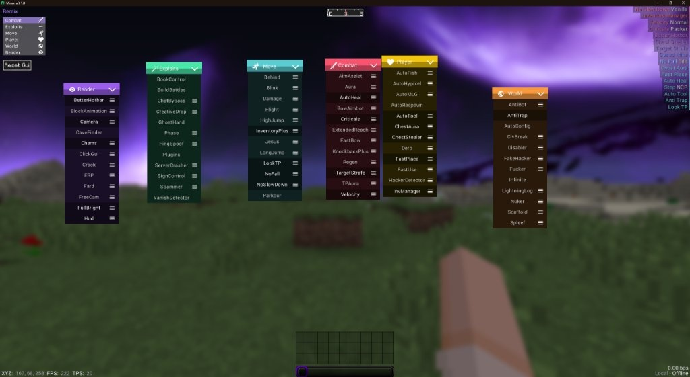

<div align="center">

# OpenRemix

**Unofficial Deobfuscated, Audited & Standalone-Buildable Java 8 Source Recovery of Remix `1.7.1`**

[English](README.md) · [简体中文](README.zh-CN.md)

[](https://www.minecraft.net/)
[-ED8B00?style=flat-square&logo=openjdk&logoColor=white)](https://adoptium.net/)
[](src/main/java/)
[](build.gradle)

<br />




</div>

---

## Overview

**OpenRemix** is an unofficial reverse-engineering and source recovery project for the **Remix `1.7.1`** Minecraft `1.8` client.

Starting from a heavily obfuscated historical JAR containing an outer attach/loader wrapper, `12,068` masked-gzip hidden class payloads, constant/string obfuscation, and destructive anti-analysis/license callbacks, this repository provides a **standard Java 8 Gradle / `javac` codebase** (`3,321` `.java` files) that compiles directly from source with **no original JAR**, **no external mapping files**, and **no bytecode post-processing**.

### Key Outcomes

- **Standalone Plain-Java Build (`3,321` files → `3,538` classes):** All `36,209` generated protection wrappers, masked payloads, and ABI post-processing stages have been removed. Standard Gradle (`gradlew clean build`) or JDK 8 `javac` (`Build-Plain.ps1`) compiles directly to `Remix-1.7.1.jar`.
- **Deobfuscation & Semantic Repackaging:** `0` `Class_<hash>` files, `0` 1–2 char obfuscated class names, and `0` `field_<hash>` identifiers remain. Core client modules under `remix/module/` (`162` files) use readable semantic names; only `6` `method_<hash>` occurrences remain across `4` files in that directory.
- **Java & Hidden-Payload Entry-Point Audit:** Stripped the outer attach/native loader (`95` entries), neutralized destructive license-failure callbacks and an animal-constructor thread bomb, removed legacy telemetry/auth gates, hardened command/path/TLS boundaries, and locked `43` dependencies (upgrading Log4j to `2.26.1`, Netty to `4.1.140.Final`, plus Guava, Gson, Commons, and HttpClient).
- **Runtime Defect Fixes:** Resolved world persistence, Netty direct `ByteBuf` decoding, OptiFine CTM sprite indexing, ClickGUI/HUD/command registration, server movement packet gating, FullBright/Xray brightness ownership, Scaffold, and MotionBlur defects.
- **Technical Write-ups:**
  - [`docs/Remix-1.6.3-Recovery-WP.zh-CN.md`](docs/Remix-1.6.3-Recovery-WP.zh-CN.md) — From-scratch recovery methodology (`1.6.3`)
  - [`docs/Remix-1.7.1-Recovery-WP.zh-CN.md`](docs/Remix-1.7.1-Recovery-WP.zh-CN.md) — Cross-version migration, entry-point audit & standalone build recovery (`1.7.1`)

---

## Observed Source Metrics

| Check | Observed Metric | Notes |
| :--- | :--- | :--- |
| Protection layers & post-processing | **Removed** | No `o/`/`g/` generated wrappers, masked gzip payloads, or ABI rewrites |
| `Class_<hash>` / 1–2 char class names | **`0`** | All `3,321` `.java` files organized into semantic packages |
| `field_<hash>` identifiers | **`0`** | Cleared across the entire tree |
| `method_<hash>` in `remix/module/` (`162` files) | **`6` hits in `4` files** | Core module implementations are directly readable |
| `method_<hash>` across full tree (`3,321` files) | **`1,391` declarations in `989` files** | `451` in `remix/` (mostly legacy flow-sentinel getters and disabled legacy-auth helpers) |
| MCP SRG names (`func_*` / `field_*`) | **`0` in `remix/`** | Present only under `net/`, `optifine/`, and `shadersmod/` |
| Compiler & legacy compat layer | **Retained as plain Java** | `remix.compat.compiler` (`JvmBooleanSlots`, `JvmThrowTypes`) and disabled `remix.compat.legacy.*` |
| Decompiler comments | **Stripped on export** | Removed Vineflower decompiler comments (including control-flow/monitor notes) without changing code |

> **Identifier Note:** Original variable/method names and comments were stripped prior to distribution of the obfuscated binary. Identifiers in this repository were reconstructed from MCP `1.8`, OptiFine, bytecode structure, and call semantics.

---

## Verification Matrix

| Target | Verified Scope | Not Claimed / Out of Scope |
| :--- | :--- | :--- |
| **`1.6.3` audited baseline** *(methodology documented in WP)* | `25,004` sources + `119` post-processing stages; normal world & village generation, `625` disk chunk reloads, repeated save-quit, ClickGUI/config, local protocol `47` TCP + zlib, multiplayer gameplay observation | Full `86`-module matrix, online Mojang auth, instruction-level audit of third-party natives |
| **`1.6.3` LegacyPing incremental fix** | Targeted Netty pipeline regression (`18` cases / `154` assertions) fixing direct-buffer backing-array and outbound release defects; verified separately from the installed `1.6.3` baseline | Arbitrary TCP fragmentation & full server-list fallback |
| **`1.7.1` standalone source build** *(this repository)* | Clean JDK 8 Gradle & `javac` builds (`3,321` `.java` → `3,538` classes); local protocol `47` server connection (`94` modules registered), event bus, Speed/TargetStrafe, Language/Stats/ClickGUI/Creative screens, config fault isolation, FullBright/Xray/MotionBlur, singleplayer world creation + `/time set 1000` + save-quit | All `94` module combinations, external online authentication, arbitrary third-party resource/shader packs, deep auditing of third-party native binaries (e.g. LWJGL/JNA) |

---

## Building from Source

### Prerequisites
- **JDK 8** (64-bit, e.g. [Adoptium Temurin 8](https://adoptium.net/temurin/releases/?version=8))

### Option 1: Gradle (Recommended)

Windows PowerShell:

```powershell
$env:JAVA_HOME = 'C:\path\to\jdk8'
.\gradlew.bat clean build
```

Linux / macOS:

```bash
export JAVA_HOME=/path/to/jdk8
./gradlew clean build
```

- Output: `build/libs/Remix-1.7.1.jar`
- All `43` application dependencies are bundled under `libs/` (see [`DEPENDENCIES.txt`](DEPENDENCIES.txt)). After the Gradle Wrapper downloads Gradle `8.12` once, subsequent builds work offline with `--offline`.

### Option 2: Plain `javac` + `jar` (No Gradle Required)

Windows PowerShell:

```powershell
.\Build-Plain.ps1 -Jdk8Root 'C:\path\to\jdk8'
```

- Output: `build/javac/Remix-1.7.1.jar`

### Runtime Notes

- **Entry point:** `net.minecraft.client.main.Main`. Launching the client requires a standard Minecraft `1.8` launcher environment (game `assets`, platform LWJGL/JInput natives, and the `43` JARs in `libs/`).
- **Plaintext credential storage:** Preserving original client behavior, saving entries via the in-game account or proxy managers writes user-entered passwords in **plaintext** to `Accounts.txt` (`remix/config/AccountsTextConfig.java`) and `Proxies.txt` (`remix/config/ProxiesTextConfig.java`). Do not store sensitive credentials there.
- **Third-party natives:** Security review focused on application Java classes and hidden payloads; third-party native libraries (such as LWJGL/JInput and JNA's bundled native binaries) were checked for provenance and diffs rather than reverse-engineered instruction by instruction.

---

## Repository Structure

```text
OpenRemix/
├── src/main/java/
│   ├── net/minecraft/         # 2,281 Minecraft 1.8 client/integrated-server/protocol classes
│   ├── remix/                 # 861 Remix client classes
│   │   ├── client/            # Startup & core assembly (ClientStartup, RemixClient)
│   │   ├── module/            # 94 client modules by category (162 files)
│   │   ├── event/             # Event bus & subscriptions
│   │   ├── command/           # Client commands
│   │   ├── config/ & setting/ # JSON/text configs & module settings
│   │   ├── ui/                # ClickGUI, TabGUI, HUD, alt/proxy screens
│   │   ├── security/          # Path, TLS, command & blocked-op guards
│   │   └── compat/            # Plain-Java compiler/library adapters & disabled legacy auth
│   ├── optifine/              # 114 OptiFine classes
│   ├── shadersmod/            # 50 ShadersMod classes
│   └── com/                   # 15 third-party API helpers
├── src/main/resources/        # Client assets, shaders & resources
├── libs/                      # 43 locked compile/runtime dependencies (incl. 2 locally adapted Mojang compat JARs)
├── docs/
│   ├── images/                # In-game screenshots
│   ├── Remix-1.6.3-Recovery-WP.zh-CN.md
│   └── Remix-1.7.1-Recovery-WP.zh-CN.md
├── build.gradle               # Standard Gradle Java 8 build script
├── Build-Plain.ps1            # Zero-Gradle javac/jar build script
└── DEPENDENCIES.txt           # Locked 43-library coordinate manifest
```

---

## About Remix `1.6.3`

The recovery methodology was first established on **Remix `1.6.3`** (`25,004` Java files + `119` post-processing stages). Because `1.6.3` was not pushed through full class renaming or standalone plain-build migration, its source tree is omitted from this branch to keep the repository clean; its technical write-up is archived in [`docs/Remix-1.6.3-Recovery-WP.zh-CN.md`](docs/Remix-1.6.3-Recovery-WP.zh-CN.md).

---

## Disclaimer

- Published **strictly for educational, security auditing, and Java deobfuscation research**.
- No original obfuscated binaries are distributed here. No copyright ownership is claimed over Minecraft, OptiFine, ShadersMod, third-party fonts/libraries, or original Remix code.
- Using modified clients on servers that prohibit them violates server rules and terms of service; users are solely responsible for their actions.
