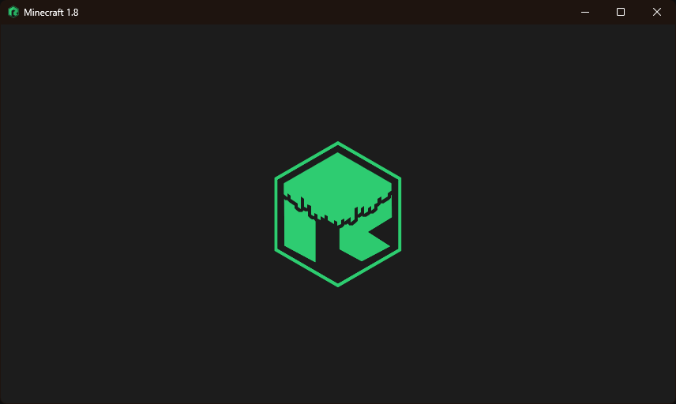

# OpenRemix

[简体中文](README.zh-CN.md)

OpenRemix is the recovered Java source for **Remix 1.7.1**, a Minecraft 1.8 client. It follows the original client and includes stability and compatibility fixes.




## Build

Use the Gradle wrapper with JDK 8 for compilation. Set `REMIX_JDK8` to your JDK 8 installation if Gradle uses a different JDK.

```powershell
# Windows
$env:REMIX_JDK8 = 'C:\path\to\jdk8'
.\gradlew.bat build
```

```bash
# Linux / macOS
export REMIX_JDK8=/path/to/jdk8
./gradlew build
```

The JAR is written to `build/libs/Remix-1.7.1.jar`. On Windows, you can also run `.\Build-Plain.ps1 -Jdk8Root 'C:\path\to\jdk8'` to build with `javac` and `jar` directly. That script writes to `build/javac/Remix-1.7.1.jar`.

Launch through a Minecraft 1.8 profile with the game assets and platform natives. The entry point is `net.minecraft.client.main.Main`. Add the JARs in `libs/` to the classpath. See [DEPENDENCIES.txt](DEPENDENCIES.txt) for the library list. The in-game account and proxy managers store passwords in plaintext.

## Recent fix

- Fixed an OptiFine cape image conversion loop that could leave texture downloader threads busy and cause sustained high CPU usage in multiplayer.

Remix, Minecraft, OptiFine, and the bundled libraries are credited to their respective authors.
