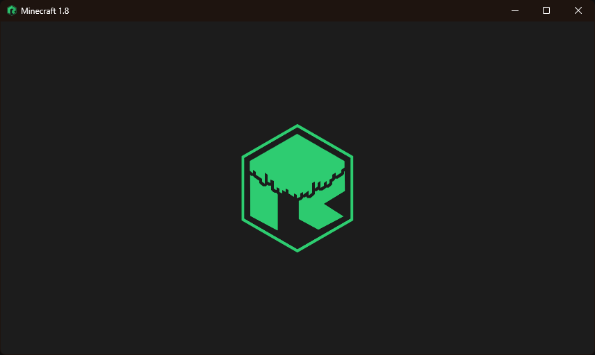
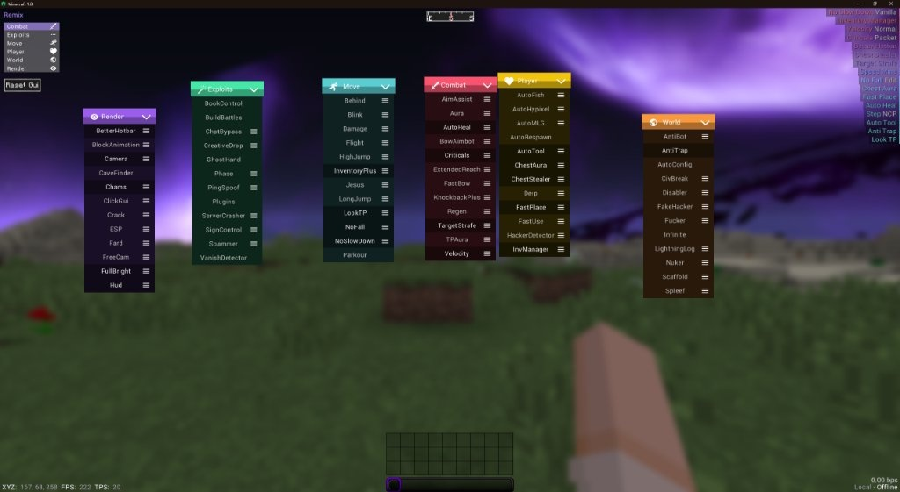

# OpenRemix

[English](README.md)

OpenRemix 是 Minecraft 1.8 客户端 **Remix 1.7.1** 的源码恢复项目。这个版本保留原版玩法，包含运行稳定性和兼容性修复。




## 构建

用 Gradle Wrapper 构建，编译需要 JDK 8。如果 Gradle 用的是其他版本的 JDK，将 `REMIX_JDK8` 指向你的 JDK 8 安装目录。

```powershell
# Windows
$env:REMIX_JDK8 = 'C:\path\to\jdk8'
.\gradlew.bat build
```

```bash
# Linux / macOS
export REMIX_JDK8=/path/to/jdk8
./gradlew build
```

构建产物在 `build/libs/Remix-1.7.1.jar`。Windows 上也可以运行 `.\Build-Plain.ps1 -Jdk8Root 'C:\path\to\jdk8'`，直接用 `javac` 和 `jar` 构建，产物在 `build/javac/Remix-1.7.1.jar`。

用 Minecraft 1.8 启动配置运行，准备好游戏资源和平台原生库。入口为 `net.minecraft.client.main.Main`，把 `libs/` 下的依赖加到 classpath。依赖清单见 [DEPENDENCIES.txt](DEPENDENCIES.txt)。游戏内的账号和代理管理器会明文保存密码。

## 最近修复

- 修复 OptiFine 披风图片处理中的死循环。旧版遇到部分披风时，纹理下载线程会持续占用 CPU，多人游戏中更容易遇到。

感谢 Remix、Minecraft、OptiFine 和随附依赖的原作者。
